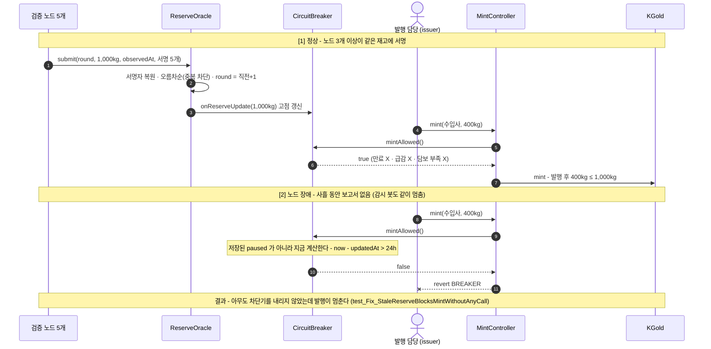
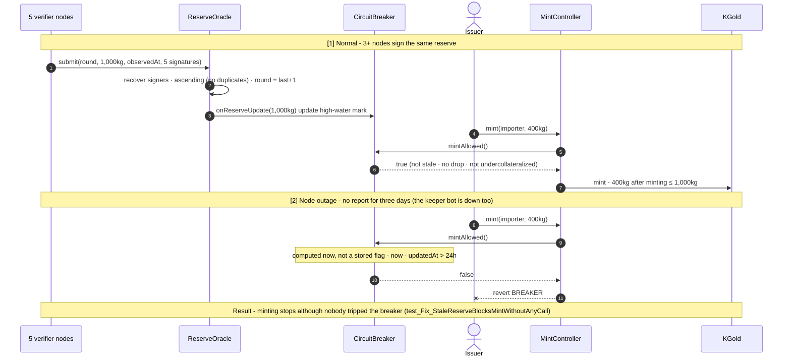

# K-Gold 핵심 모듈 구현 — 보유고 증명 · 발행 한도 · 회로차단기


핀테크 아이디어 공모전에서 설계한 금 담보 B2B 정산 시스템 **K-Gold** 의 핵심 모듈을 직접 구현한 학습용 저장소입니다. 지난 글들에서 여러 번 "핵심 모듈(토큰 발행 로직, Circuit Breaker, 다중 서명 검증)을 구현해 공개하겠다" 고 적었는데, 이번에 그 약속을 코드로 옮겼습니다. 설계 문서에만 있던 규칙을 컨트랙트 네 개(`KGold` · `MintController` · `ReserveOracle` · `CircuitBreaker`)로 만들고, 처음 세웠던 설계가 깨지는 지점 네 군데를 **`처음 떠올린 설계(반례)` ↔ `고친 설계`** 쌍으로 남겨 Foundry 테스트 25개와 불변식 퍼즈 테스트로 확인했습니다.

> ⚠️ 이 저장소는 **설계를 코드로 옮겨보며 어디서 깨지는지 확인하려는 학습용**입니다. 실제 수탁기관·검증 노드·금 시세와 연동되지 않았고, 금융·법률 검토를 거친 설계가 아닙니다. 어떤 코드도 프로덕션용이 아닙니다.

---

## 프로젝트 핵심 요소

1. **설계 문장을 컨트랙트 규칙으로 옮기기**
   - 1토큰 = 금 1그램 (`decimals = 3`, 최소 단위 1mg). 보유고 증명도 mg 단위라 **발행량과 보관 중량을 단위 변환 없이 바로 비교**
   - 발행 규칙은 한 줄: `발행 후 총량 ≤ 검증 노드 5개 중 3개 이상이 서명한 보관 중량`
   - 회로차단기 감지 조건 4개(증명 만료 · 재고 급감 · 담보 부족 · 수동 정지)를 **저장하지 않고 매번 계산하는 view** 로 구현

2. **처음 떠올린 설계가 깨지는 것을 테스트로 증명 (반례 4종)**
   - 가치 기준 발행 한도: 금값이 20% 내리면 **한도가 발행량 밑으로** 내려가고, 되돌릴 방법이 없다
   - 서명 개수만 세는 오라클: 노드 **하나가 같은 서명을 세 번** 내면 정족수가 채워진다 · **일주일 전 보고서**를 다시 내면 사라진 금 400kg 이 되살아난다
   - `check()` 를 불러야 내려가는 차단기: 오라클과 감시 봇이 같이 멈추면 **사흘 전 재고 기준으로 발행이 계속**된다
   - 직전 대비 급감 비교: 4%씩 다섯 번 빼면 **한 번도 안 걸리고 18% 가 사라진다**

3. **"발행량 ≤ 증명된 보관 중량" 을 불변식 퍼즈 테스트로 반복 검증**
   - 노드 5개 중 2개를 악의적으로 두고, 퍼저가 정직한 보고 · 거짓 보고(서명 중복 포함) · 발행 · 상환 · 시간 경과 · 점검을 무작위 순서로 **16,384번** 호출
   - 불변식 4개 전부 유지. 그리고 이 테스트가 **정말 무언가를 검사하는지** 확인하려고 발행 한도 검사와 만료 검사를 일부러 지운 버전을 돌려, 둘 다 잡히는 것까지 확인했다(트러블슈팅 참고)

---

## 시스템 아키텍처 & 라이프사이클 흐름

가장 배울 게 많았던 **증명 만료** 의 흐름입니다. 처음엔 `paused` 를 저장해 두고 감시 봇이 `check()` 를 불러 내리는 구조였는데, **차단기가 필요한 순간이 곧 차단기를 내려 줄 사람도 멈춘 순간**이었습니다.



**한 줄 요약:** 차단기의 상태를 저장해 두면, 그 상태를 바꿔 줄 누군가가 살아 있어야 한다. 이상 상황에서는 그 누군가도 멈춰 있을 가능성이 높다. 그래서 차단 조건을 **발행·전송이 일어나는 순간 그 자리에서 계산** 하도록 바꿨다. 사람이 거는 수동 정지만 저장한다.

---

## 처음 떠올린 설계 4종 & 확인한 것

| # | 처음 떠올린 설계 | 반례 파일 | 깨지는 것을 보인 테스트 | 어긋난 지점 |
|---|---|---|---|---|
| 01 | 발행 한도 = 보관 중량 × 금 시세 | `naive/NaiveValueCappedMinter.sol` | `test_Exploit_PriceDropPushesCapBelowSupply` | 한도를 **무엇으로 세느냐** (가치 → 중량) |
| 02 | 노드 서명 3개 이상이면 인정 | `naive/NaiveReserveOracle.sol` | `test_Exploit_OneNodeCountedThreeTimes` · `test_Exploit_OldReportReplayed` | **누구를 몇 번** 셌는지, **언제** 것인지를 안 봄 |
| 03 | 감시 봇이 `check()` 로 차단기를 내림 | `naive/NaiveStaleBreaker.sol` | `test_Exploit_KeeperDownMeansNoTrip` | **모를 때** 기본값이 "계속 발행" |
| 04 | 재고가 직전보다 5% 이상 줄면 정지 | `naive/NaiveDropBreaker.sol` | `test_Exploit_SlowDrainNeverTrips` | 비교 **기준점**이 매번 내려감 |

### 01 — 한도는 "얼마어치" 가 아니라 "몇 그램" 이었다
K-Gold 글에서 "발행 상한을 컨트랙트에 하드코딩한다는 명제는 성립하지 않았다, 담보 가치는 결국 가격 오라클의 출력이다" 라고 썼다. 그때는 문제만 찾고 답은 못 냈다. 반례를 직접 만들어 보니 문제는 오라클 의존보다 더 근본적이었다. 금값이 내리면 한도가 내려가는데, **이미 남의 지갑에 들어간 토큰은 줄일 방법이 없다**(있어서도 안 된다). 한도가 발행량 밑으로 내려가는 순간 불변식이 깨지고 고칠 수단이 없다.

그래서 토큰을 가치가 아니라 **중량**으로 정의했다. 1토큰 = 1그램이면 금값은 비교식 어디에도 등장하지 않는다. 대신 가격 위험이 사라진 게 아니라 **이 토큰을 담보로 쓰는 쪽(무역 에스크로의 담보 비율)으로 옮겨갔다** — 이건 아직 구현하지 않았다.

### 02 — 서명이 "진짜" 인 것과 보고서가 "유효" 한 것은 다르다
21회차에서 서명에서 서명자를 복원(`ecrecover`)해 "서명이 곧 권한" 이 되는 구조를 배웠다. 그래서 처음엔 복원한 주소가 노드면 하나씩 세는 것으로 충분하다고 생각했다. 그런데 노드 하나가 **같은 서명을 세 번** 넣으면 셋 다 진짜 서명이라 3으로 세어졌다. 그리고 재고가 600kg 으로 줄어든 뒤 **일주일 전 1,000kg 보고서**를 다시 내면, 그때 3명이 서명한 것도 사실이라 그대로 통과했다.

고친 오라클은 다섯 가지를 더 본다. 서명자 주소가 **엄격하게 증가**해야 하고(정렬을 강제하면 중복이 저절로 막힌다), round 는 **정확히 직전 + 1**, 관측 시각은 **직전보다 나중**이면서 제출 시점 기준 **1시간 이내**, EIP-712 도메인에 **chainId 와 컨트랙트 주소**를 넣어 다른 배포본의 서명을 못 쓰게 하고, **s 값을 절반 이하**로 제한해 같은 서명의 다른 모양을 막는다. 하나하나는 21회차·22회차에서 본 것들인데, 다중 서명에서는 이걸 **전부 동시에** 챙겨야 했다.

### 03 — 차단기가 필요한 순간에 차단기를 내려 줄 사람이 없다
SEC 랩 02 에서 `require(!oracle.halted())` 가 오라클이 침묵하면 거래를 허용한다는 걸 봤다. 그래서 이번엔 처음부터 만료 검사를 넣었다 — 감시 봇이 주기적으로 `check()` 를 불러서 보고서가 24시간 넘게 없으면 `paused = true`. 그런데 노드가 멈출 정도의 장애라면 같은 서버·같은 RPC 를 쓰는 감시 봇도 같이 멈춰 있을 가능성이 높다. 아무도 `check()` 를 안 부르면 `paused` 는 false 로 남고, **같은 문제가 차단기 자체에서 다시 나왔다.**

고친 차단기는 수동 정지를 뺀 모든 조건을 `view` 로 바꿨다. 발행할 때마다 `MintController` 가 `mintAllowed()` 를 부르고, 그 안에서 `now - updatedAt > 24h` 를 바로 계산한다. 아무도 호출하지 않아도 발행이 멈춘다.

### 04 — 비교 기준을 매번 새로 잡으면 경계를 나눠서 넘을 수 있다
"직전 증명 대비 5% 이상 감소하면 정지" 를 그대로 옮기니, 4%씩 다섯 번 빼면 한 번도 안 걸리고 18% 가 사라졌다. SEC 랩의 자정 경계 문제와 같은 모양이다 — 거기선 일 단위로 집계를 끊어서 경계 양쪽에 한도를 두 번 썼고, 여기선 비교 기준이 매번 직전 값으로 내려가서 한도를 여러 번 나눠 썼다.

고친 차단기는 **마지막 점검 이후의 최고점** 대비로 비교한다. 같은 4% 감소가 두 번째에서 걸린다(누적 7.84%). 재고가 늘면 고점도 따라 올라가서, 2,000kg 까지 늘었다가 1,000kg 으로 반토막 나는 것도 잡는다. 운영자가 점검 후 정상이라고 판단하면 `acknowledgeReserve()` 로 고점을 현재 값으로 내린다. 단, **발행량이 보관량보다 많으면 점검만으로는 안 풀린다** — 상환으로 발행량이 줄어야 풀린다(`test_Fix_UndercollateralizedNeedsRedemptionNotJustReview`).

### 그리고 — 내 수정본도 완전하지 않다
- **노드 3개가 짜면 막을 수 없다.** 거짓 재고 10,000kg 이 인정되고 실제로 없는 금 9,000kg 어치가 발행되는데, 차단기도 이상을 못 본다(`test_Limit_ThreeColludingNodesWin`). 버그가 아니라 3-of-5 라는 신뢰 가정 그 자체다. K-Gold 글에서 "신뢰를 없앤 게 아니라 분산시킨 것에 가깝다" 고 쓴 게 테스트 한 줄로 남았다.
- **고점 리셋은 결국 사람의 판단이다.** `acknowledgeReserve()` 를 부르는 운영자가 확인 없이 리셋하면 급감 차단이 무력해진다. 절차를 코드로 강제하는 건 지난 스테이블코인 글의 질문과 같은 자리라, 아직 답이 없다.
- **증명 만료 때 전송은 막지 않았다.** "재고를 모른다" 와 "금이 사라졌다" 는 다르다고 봐서 발행만 멈췄다. 이게 맞는 선택인지는 확신이 없다.
- **가격 위험은 에스크로로 미뤄 뒀다.** 담보 비율 감시는 무역 에스크로(아직 미구현)에서 다뤄야 한다.

---

## 기술 스택

| 구분 | 사용 기술 |
|---|---|
| **언어 / 컴파일러** | Solidity `0.8.25` (`foundry.toml` 에 고정) |
| **개발 · 테스트 프레임워크** | Foundry `1.8.1` (forge test, invariant testing, cheatcodes: `vm.sign`, `vm.prank`, `vm.warp`, `vm.expectRevert`) |
| **테스트 라이브러리** | forge-std `v1.16.2` |
| **서명** | EIP-712 구조화 서명 + `ecrecover` (EIP-2 low-s 검사) |
| **환경** | macOS (Apple Silicon) |
| **참고 자료** | K-Gold 설계(핀테크 아이디어 공모전), 블록체인 밋업데이 21회차(Wallet · EIP-712) · 22회차(스마트컨트랙트 보안) 교재 |

---

## 트러블슈팅 및 환경 최적화

> **불변식 테스트가 통과했는데, 사실 아무것도 검사하지 않고 있었다**
> - **문제 상황:** 불변식 4개가 16,384번 호출 동안 전부 통과했다. 그런데 확인 삼아 `MintController` 의 `EXCEEDS_RESERVE` 검사를 **일부러 지우고** 다시 돌려도 여전히 통과했다. 발행 한도가 없는 컨트랙트에서 "발행량 ≤ 보관량" 이 지켜질 리가 없다.
> - **원인 분석:** 실행마다 성공한 발행 횟수를 찍어 보니(`afterInvariant` 에서 `mintsSucceeded` 출력) **한 실행에 4~6번** 뿐이었다. 한 번에 최대 100kg 씩 몇 번 발행해서는 1,000kg 한도에 한 번도 닿지 않았다. 퍼저가 검사 대상인 경로까지 가지 못한 것이다.
> - **해결 방안:** 발행 범위를 최대 500kg 으로 넓혀 한도에 실제로 닿게 했고, 재고 급감으로 차단기가 걸린 뒤 영영 안 풀리지 않도록 운영자 점검(`review`) 행동을 추가했다. 그 다음 **검사를 지운 버전 두 개(한도 검사 제거 · 만료 검사 제거)** 를 다시 돌려 각각 `invariant_NoMintAboveReserve` · `invariant_NoMintWhileStale` 가 실패하는 것을 확인하고 원래 코드로 되돌렸다. 22회차에서 "통과하는 테스트가 문제를 가린다" 를 배웠는데, 퍼즈 테스트에서는 그게 **"통과하는 퍼즈 테스트가 아무것도 안 보고 있다"** 로 나타났다.

> **`forge lint` 의 block-timestamp 경고 — 고치지 않기로 한 판단**
> - **문제 상황:** 빌드할 때마다 `warning[block-timestamp]: usage of block.timestamp in a comparison may be manipulated by validators` 가 `CircuitBreaker.isStale()` 과 `ReserveOracle.submit()` 에 떴다.
> - **원인 분석:** 블록 생성자가 타임스탬프를 약간(수 초) 조정할 수 있으니 시간 비교를 조심하라는 경고다.
> - **해결 방안:** 그대로 두었다. 여기서 비교하는 단위는 **24시간(증명 만료)과 1시간(보고서 유효 시간)** 이라 수 초의 조정은 의미가 없고, 증명 만료는 시간 말고는 표현할 방법이 없다. 대신 경계가 정확히 어디인지는 `test_Boundary_StalenessAtExactly24Hours` 로 고정해 두었다(24시간째는 허용, 1초 뒤는 차단).

---

## 실행 가이드 (Quick Start)

### 사전 조건 (Prerequisites)
- [Foundry](https://book.getfoundry.sh/) (`forge` 1.8.x)

### 1) 저장소 받기 & 빌드
```bash
git clone --recursive https://github.com/Andrewpark-hub/kgold-reserve-breaker-lab.git
cd kgold-reserve-breaker-lab
forge build            # solc 0.8.25 자동 사용
```

### 2) 테스트 (25개 전부 통과)
```bash
forge test -vv
```

### 3) 하나씩 따라가며 보기
```bash
forge test --match-path test/01_MintCap.t.sol -vvv         # 발행 한도 (가치 기준 반례 · 과잉 발행)
forge test --match-path test/02_ReserveOracle.t.sol -vvv   # 보유고 증명 · 다중 서명 검증
forge test --match-path test/03_CircuitBreaker.t.sol -vvv  # 회로차단기 (만료 · 급감 · 담보 부족)
forge test --match-path test/04_Invariant.t.sol -vv        # 불변식 퍼즈 테스트
```

---

## 저장소 구조

```
src/
  KGold.sol            금 담보 토큰 (1 KGOLD = 1g, 등록 기업 간 전송만)
  MintController.sol   발행 · 상환 (발행량 ≤ 증명된 보관 중량)
  ReserveOracle.sol    보유고 증명 (검증 노드 5개 중 3개 이상의 EIP-712 서명)
  CircuitBreaker.sol   증명 만료 · 재고 급감 · 담보 부족 · 수동 정지
test/
  Base.t.sol           전체 배포 + 노드 서명 헬퍼
  01_MintCap.t.sol   02_ReserveOracle.t.sol   03_CircuitBreaker.t.sol   04_Invariant.t.sol
  naive/               처음 떠올린 설계 (반례 4종)
docs/
  kgold-design-mapping.md   K-Gold 설계 → 구현/미구현 + 공격 시나리오 매핑 + 남은 질문
```

---

## 배운 것 & 다음

- K-Gold 글에서 "제거하려던 신뢰 가정이 사라진 게 아니라 한 단계 뒤로 이동했을 뿐" 이라고 썼는데, 구현해 보니 정확히 그랬다. 중량 기준으로 가격 위험을 토큰에서 뺐지만 에스크로로 옮겨갔고, 3-of-5 로 오라클 신뢰를 나눴지만 3개가 짜면 끝이고, 차단기를 자동으로 만들었지만 리셋은 사람이 한다. 다만 **어디로 옮겨갔는지가 이제 테스트 이름으로 남아 있다.**
- SEC 랩에서 정리한 세 질문이 이번에도 그대로 걸렸다. **무엇으로 세느냐**(가치 → 중량), **모를 때 어느 쪽으로 넘어지느냐**(봇이 없어도 멈추는 차단기), **어디서부터 세느냐**(직전 값이 아니라 고점). 여기에 다중 서명에서 **누구를 몇 번 셌느냐** 가 하나 더 붙었다.
- 퍼즈 테스트는 "통과했다" 만으로는 아무 말도 안 해 준다는 걸 배웠다. 검사를 일부러 지워서 테스트가 실패하는지 보는 것까지 해야 테스트를 믿을 수 있었다.
- 다음은 **무역 에스크로**다. 수입사 결재선 3명 중 2명의 EIP-712 승인, 선적 증빙 해시 등록, 기한 만료 시 환불, 그리고 여기서 미뤄 둔 **담보 비율(가격 위험)** 을 다룰 계획이다. 남은 질문은 `docs/` 에 적어 두었다.

---

*이 저장소의 반례 코드(`test/naive/`)는 학습 목적의 의도된 결함을 포함합니다. 어떤 코드도 프로덕션에 사용하지 마세요. 또한 이 저장소는 금융·법률 자문이 아닙니다.*

---
---

# Building K-Gold's Core Modules — Proof of Reserve · Mint Cap · Circuit Breaker

*English version — the Korean original is above.*


This learning repository implements the core modules of **K-Gold**, the gold-backed B2B settlement system I designed for a fintech idea competition. In several earlier posts I wrote that I would build and open-source its core modules (issuance logic, Circuit Breaker, multi-signature verification); this is that promise in code. The rules that lived only in a design document are now four contracts (`KGold` · `MintController` · `ReserveOracle` · `CircuitBreaker`), and the four places where my first design broke are kept as **`first design (counterexample)` ↔ `fixed design`** pairs, checked with 25 Foundry tests and an invariant fuzz test.

> ⚠️ This repository is **a learning exercise in turning a design into code and seeing where it breaks**. It is not connected to a real custodian, verifier nodes or gold prices, and the design has not been reviewed financially or legally. None of this code is meant for production.

---

## Key Components

1. **Turning design sentences into contract rules**
   - 1 token = 1 gram of gold (`decimals = 3`, smallest unit 1 mg). The proof of reserve also reports in mg, so **supply and vault weight compare directly, with no unit conversion**
   - The minting rule is one line: `total supply after minting ≤ vault weight signed by at least 3 of 5 verifier nodes`
   - The four breaker conditions (stale proof · reserve drop · undercollateralization · manual pause) are implemented as **views computed on every call, not stored state**

2. **Proving with tests that my first designs break (4 counterexamples)**
   - Value-based mint cap: a 20% drop in the gold price pushes **the cap below supply**, with no way back
   - An oracle that only counts signatures: **one node submitting the same signature three times** fills the quorum · resubmitting **a week-old report** brings back 400 kg of gold that is gone
   - A breaker that trips only when someone calls `check()`: if the oracle and the keeper bot go down together, **minting continues on a three-day-old reserve**
   - Drop detection against the previous report: removing 4% five times **never trips, and 18% is gone**

3. **Repeatedly checking "supply ≤ proven vault weight" with an invariant fuzz test**
   - 2 of the 5 nodes are malicious; the fuzzer calls honest reports, fake reports (including duplicated signatures), mint, redeem, time jumps and reviews in random order **16,384 times**
   - All four invariants hold. To confirm the test **actually checks something**, I deliberately deleted the mint-cap check and the staleness check in turn and confirmed both are caught (see Troubleshooting)

---

## System Architecture & Lifecycle Flow

The case I learned the most from: **a stale proof**. My first version stored `paused` and had a keeper bot call `check()` to set it — but **the moment you need the breaker is the moment whoever trips it has also stopped.**



**In one line:** if the breaker's state is stored, someone has to be alive to change it — and in an incident, that someone is likely down too. So the conditions are **computed at the moment of minting or transferring**. Only the manual pause, set by a person, is stored.

---

## The 4 First Designs & What I Found

| # | First design | Counterexample | Test showing it breaks | Where it slipped |
|---|---|---|---|---|
| 01 | Mint cap = vault weight × gold price | `naive/NaiveValueCappedMinter.sol` | `test_Exploit_PriceDropPushesCapBelowSupply` | **what you count in** (value → weight) |
| 02 | Accept if 3+ node signatures | `naive/NaiveReserveOracle.sol` | `test_Exploit_OneNodeCountedThreeTimes` · `test_Exploit_OldReportReplayed` | never checked **who was counted how many times**, or **from when** |
| 03 | A keeper bot trips the breaker via `check()` | `naive/NaiveStaleBreaker.sol` | `test_Exploit_KeeperDownMeansNoTrip` | default **when unknown** is "keep minting" |
| 04 | Pause if reserve falls 5%+ vs the previous report | `naive/NaiveDropBreaker.sol` | `test_Exploit_SlowDrainNeverTrips` | the **reference point** moves down every time |

### 01 — A cap is not "how much it's worth" but "how many grams"
In my K-Gold post I wrote that "hard-coding a supply cap turns out to be impossible — the collateral ceiling is itself an oracle output." Back then I found the problem but not the answer. Building the counterexample showed it is more fundamental than oracle dependence: when the gold price falls the cap falls, but **tokens already in other people's wallets cannot be reduced** (nor should they be). The moment the cap drops below supply the invariant is broken, with no way to repair it.

So the token is defined by **weight**, not value. If 1 token = 1 gram, the gold price never appears in the comparison. The price risk did not disappear, though — **it moved to whoever uses the token as collateral (the trade escrow's collateral ratio)**, which is not built yet.

### 02 — A "genuine" signature is not the same as a "valid" report
In the 21st session I learned how recovering the signer from a signature (`ecrecover`) makes "the signature is the authority." So at first I thought counting each recovered node address was enough. But when one node submitted **the same signature three times**, all three were genuine and counted as 3. And after the reserve fell to 600 kg, resubmitting **a week-old 1,000 kg report** passed too — it was true that three nodes had signed it.

The fixed oracle checks five more things: signer addresses must be **strictly increasing** (forcing order rules out duplicates for free); the round must be **exactly last + 1**; the observation time must be **later than the last** and **within 1 hour** of submission; the EIP-712 domain includes **chainId and the contract address** so signatures from another deployment don't work; and **s is limited to the lower half** to block a second shape of the same signature. Each of these I had seen in the 21st or 22nd session — multi-signature verification needed **all of them at once**.

### 03 — When you need the breaker, nobody is there to trip it
In SEC lab 02 I saw `require(!oracle.halted())` allow trading while the oracle is silent. So this time I added a staleness check from the start: a keeper bot periodically calls `check()` and sets `paused = true` if no report has arrived for 24 hours. But an outage serious enough to stop the nodes likely stops a keeper running on the same server and the same RPC. If nobody calls `check()`, `paused` stays false — **the same problem came back inside the breaker itself.**

The fixed breaker turns every condition except the manual pause into a `view`. On every mint, `MintController` calls `mintAllowed()`, which computes `now - updatedAt > 24h` right there. Minting stops even if nobody calls anything.

### 04 — Re-basing the comparison every time lets you cross the limit in slices
Translating "pause if the reserve falls 5%+ versus the previous proof" literally, removing 4% five times never tripped and 18% disappeared. It's the same shape as the midnight-boundary problem in the SEC lab — there, bucketing by day let the cap be used twice across the boundary; here, the reference dropping to the previous value each time let the limit be used in slices.

The fixed breaker compares against **the highest reserve since the last review**. The same 4% drop trips on the second report (7.84% cumulative). The high-water mark follows deposits up, so growing to 2,000 kg and halving to 1,000 kg is caught too. After a review, the operator calls `acknowledgeReserve()` to reset the mark to the current value. But **if supply exceeds the reserve, a review alone does not clear it** — supply has to come down through redemption (`test_Fix_UndercollateralizedNeedsRedemptionNotJustReview`).

### And — my fix is not complete either
- **Three colluding nodes cannot be stopped.** A fake 10,000 kg reserve is accepted, 9,000 kg worth of tokens backed by nothing are minted, and the breaker sees nothing wrong (`test_Limit_ThreeColludingNodesWin`). Not a bug — it is the 3-of-5 trust assumption itself. What I wrote in the K-Gold post, "trust wasn't removed, it was distributed," is now one test.
- **Resetting the high-water mark is still a human decision.** If the operator calls `acknowledgeReserve()` without checking, drop detection is defeated. Enforcing that procedure in code is the same open question as in my stablecoin post.
- **Transfers are not paused when the proof is stale.** I treated "we don't know the reserve" as different from "the gold is gone," so only minting stops. I'm not sure it's the right call.
- **Price risk is deferred to the escrow.** Collateral-ratio monitoring belongs in the trade escrow, which is not built yet.

---

## Tech Stack

| Category | Technology |
|---|---|
| **Language / Compiler** | Solidity `0.8.25` (pinned in `foundry.toml`) |
| **Dev & Test Framework** | Foundry `1.8.1` (forge test, invariant testing, cheatcodes: `vm.sign`, `vm.prank`, `vm.warp`, `vm.expectRevert`) |
| **Test Library** | forge-std `v1.16.2` |
| **Signatures** | EIP-712 typed data + `ecrecover` (EIP-2 low-s check) |
| **Environment** | macOS (Apple Silicon) |
| **Source Material** | K-Gold design (fintech idea competition); Blockchain Meetup Day session 21 (Wallet · EIP-712) and 22 (smart contract security) materials |

---

## Troubleshooting & Environment Notes

> **The invariant test passed — while checking nothing**
> - **Problem:** all four invariants passed over 16,384 calls. But when I **deliberately deleted** the `EXCEEDS_RESERVE` check in `MintController` and reran it, it still passed. A contract with no mint cap cannot possibly keep "supply ≤ reserve."
> - **Root cause:** printing successful mints per run (`mintsSucceeded` in `afterInvariant`) showed **only 4–6 per run**. A few mints of up to 100 kg each never reached the 1,000 kg cap. The fuzzer never got to the path under test.
> - **Fix:** widened the mint range to 500 kg so the cap is actually reached, and added an operator `review` action so the breaker does not stay tripped forever after a reserve drop. Then I reran **two broken versions (cap check removed · staleness check removed)**, confirmed `invariant_NoMintAboveReserve` and `invariant_NoMintWhileStale` fail respectively, and restored the code. In session 22 I learned that "a passing test can hide the problem"; with fuzzing it showed up as **"a passing fuzz test that isn't looking at anything."**

> **The `block-timestamp` lint from `forge lint` — a warning I chose not to act on**
> - **Problem:** every build printed `warning[block-timestamp]: usage of block.timestamp in a comparison may be manipulated by validators` for `CircuitBreaker.isStale()` and `ReserveOracle.submit()`.
> - **Root cause:** block producers can shift the timestamp slightly (seconds), so the linter warns about time comparisons.
> - **Fix:** left as is. The windows compared here are **24 hours (proof staleness) and 1 hour (report freshness)**, so a few seconds are irrelevant, and staleness has no way to be expressed except through time. Instead the exact boundary is pinned by `test_Boundary_StalenessAtExactly24Hours` (allowed at exactly 24h, blocked one second later).

---

## Quick Start

### Prerequisites
- [Foundry](https://book.getfoundry.sh/) (`forge` 1.8.x)

### 1) Clone & build
```bash
git clone --recursive https://github.com/Andrewpark-hub/kgold-reserve-breaker-lab.git
cd kgold-reserve-breaker-lab
forge build            # uses solc 0.8.25 automatically
```

### 2) Run the tests (all 25 pass)
```bash
forge test -vv
```

### 3) Follow one at a time
```bash
forge test --match-path test/01_MintCap.t.sol -vvv         # mint cap (value-based counterexample · over-mint)
forge test --match-path test/02_ReserveOracle.t.sol -vvv   # proof of reserve · multi-signature verification
forge test --match-path test/03_CircuitBreaker.t.sol -vvv  # circuit breaker (stale · drop · undercollateralized)
forge test --match-path test/04_Invariant.t.sol -vv        # invariant fuzz test
```

---

## Repository Structure

```
src/
  KGold.sol            gold-backed token (1 KGOLD = 1 g, transfers only between registered companies)
  MintController.sol   mint · redeem (supply ≤ proven vault weight)
  ReserveOracle.sol    proof of reserve (EIP-712 signatures from 3 of 5 verifier nodes)
  CircuitBreaker.sol   stale proof · reserve drop · undercollateralization · manual pause
test/
  Base.t.sol           full deployment + node signing helpers
  01_MintCap.t.sol   02_ReserveOracle.t.sol   03_CircuitBreaker.t.sol   04_Invariant.t.sol
  naive/               my first designs (4 counterexamples)
docs/
  kgold-design-mapping.md   K-Gold design → built / not built, attack scenarios, open questions
```

---

## What I Learned & What's Next

- In the K-Gold post I wrote that "the trust assumption I wanted to remove didn't disappear — it just moved one layer back." Building it confirmed exactly that. Weight-based units took price risk out of the token but moved it to the escrow; 3-of-5 split oracle trust, but three colluding nodes win; the breaker is automatic, but a person resets it. The difference is that **where it moved is now written down as test names.**
- The three questions from the SEC lab came back again: **what you count in** (value → weight), **which way you fall when you don't know** (a breaker that stops without a bot), and **where you count from** (the high-water mark, not the previous value). Multi-signature verification added one more: **who was counted, how many times.**
- I learned that "it passed" says nothing about a fuzz test by itself. Only after deleting a check on purpose and watching the test fail could I trust it.
- Next is the **trade escrow**: EIP-712 approvals from 2 of the importer's 3 approvers, shipping-document hash registration, refunds after the deadline, and the **collateral ratio (price risk)** deferred from here. Open questions are written up in `docs/`.

---

*The counterexample code (`test/naive/`) contains intentional flaws for educational purposes. Do not use any of it in production. This repository is also not financial or legal advice.*
